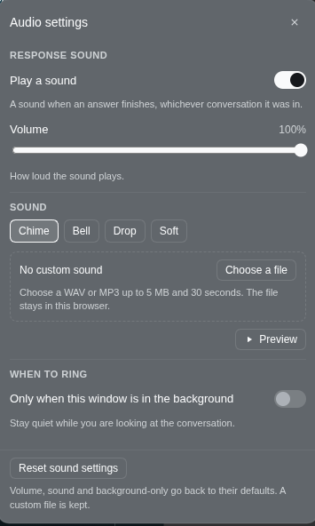

# Response Chime

Hear when the agent has finished answering.

Send a prompt, walk away, and a chime plays when the turn ends. It rings for a
long plan-and-goal run, for the moment an agent stops to ask you something, and
for a turn that finishes while you are reading another conversation, so you can
stop checking the tab.

The speaker row sits above **Settings** at the foot of the left sidebar. Click it
to open **Audio settings**. That is where you turn the chime on or off, set the
volume, choose one of four sounds, add a WAV or MP3 of your own, or keep it quiet
while you are looking at the page.

Nothing is uploaded. The built-in sounds are generated in your browser, and a
custom file stays in this browser's storage.

<p align="center">
  
</p>

## What you can do

- **Hear an answer land.** A chime plays the moment a Session that was working
  goes idle. A turn you left running calls you back when it finishes.
- **Open the audio settings panel.** The speaker row shows **On** or **Off** in
  the wide sidebar. Click it to open the panel.
- **Pick a sound.** Chime, Bell, Drop and Soft. Clicking one plays it, so you
  hear the change before you rely on it.
- **Use your own sound.** Add a WAV or MP3 up to 5 MB and 30 seconds. It is
  decoded and kept in this browser, then played at the volume you set.
- **Set the level.** The slider goes from silent to full. All four sounds and any
  custom clip are normalized to the same level. So changing the sound does not
  change the volume. At 100% it is about as loud as a normal notification.
- **Stay quiet while you are watching.** Turn on **Only when this window is in
  the background** and the chime only plays when the page is hidden or another
  window has focus.
- **Keep it set.** Your choices are saved in this browser and apply to every
  conversation in the app.

## Install

You need the DeepSeek Harness, running in a browser or the desktop app.

1. Open **Plugins** in the left sidebar.
2. Press **Install**.
3. Paste this repository's address:

   ```
   https://github.com/DevTarlow/dsh-response-chime
   ```

4. Install it, then refresh the page.

If you work from a local copy, clone the repository and paste the folder's full
path instead. The install dialog accepts a GitHub address, a package name, or a
local folder.

The plugin stays in your Harness for every session until you remove it.

## Using it

The speaker row sits above **Settings**. In the wide sidebar it shows the current
state next to the speaker; in the narrow rail it becomes a round button. The icon
shows sound waves when the chime is on and a small × when it is off.

1. Click the row to open **Audio settings**.
2. **Play a sound** turns the chime on and off. Turning it back on plays the
   current sound as a preview.
3. **Volume** sets how loud it plays. The value saves as you drag.
4. **Sound** lists Chime, Bell, Drop and Soft. Click one to hear it and use it.
5. **Choose a file** replaces the built-in sound with your own WAV or MP3. Once
   one is stored, **Replace** and **Remove** sit beside its name.
6. **Preview** plays the current sound at the current volume.
7. **Only when this window is in the background** keeps the chime quiet while the
   window is visible and focused.
8. **Reset sound settings** returns volume, sound and background-only to their
   defaults. It keeps a custom file.

Press `Escape` or click outside the panel to close it. Focus goes back to the
speaker row.

## When it rings

A ring means a Session went from working to idle. That covers the times you would
otherwise keep checking:

- A normal answer finishing.
- A long plan, goal or workflow run ending.
- The model stopping to ask a question, because the turn is waiting on you.
- A background or scheduled turn ending while you are in another conversation.

It does not ring when you open the page in the middle of a turn. The first status
sets the baseline, and only a later running-to-idle change counts as an answer. It
also does not ring when a Session appears or stays idle.

With **Only when this window is in the background** on, the chime stays quiet
while the page is visible and focused. A visible but unfocused window counts as
background, because you are working somewhere else.

## Custom sounds

A custom sound is a WAV or MP3 up to 5 MB and 30 seconds. The panel decodes the
file before accepting it, so a file that is not really audio is refused with a
message instead of being played as noise.

The bytes stay in this browser's IndexedDB, so the file is never uploaded and
another browser cannot see it. The clip is normalized to the same level as the
built-in sounds, so a quiet recording and a loud one land at roughly the same
volume; the slider then scales both.

If the stored clip cannot be found or decoded later, the default chime plays
instead of leaving you with silence. **Remove** clears it, and clearing the
site's data removes it too.

## Leaving it on in the background

Browsers do not let a page make sound until you have clicked or typed in it. The
plugin creates its audio on your first click or keypress, then schedules the
notes on the audio clock, which does not advance while sound is blocked. And if
you typed the prompt in this page, the chime plays even when the tab is in the
background and the screen is off. A custom clip is decoded from that first
gesture too, so it is ready when a turn ends.

## Common questions

**I hear nothing.** Open **Audio settings** and check that **Play a sound** is on.
If it is, click once in the page and send a short prompt; a page that has never
been clicked cannot make sound yet. Check the system volume and the tab's mute
state as well. At 100% the chime is about as loud as a normal notification. If a
custom sound is selected and its file is gone, the default chime plays instead;
choose another file to replace it.

**Can I make it louder?** 100% is the top of the slider and is a normal
notification level. If you need more, raise the system volume or the app's
volume. But the plugin does not boost above that.

**Can I change the sound or the volume?** The panel has four built-in sounds, a
custom WAV or MP3, and a volume slider. Every sound is normalized to the same
level, so changing the sound does not change how loud it is. The default is the
original two-note chime.

**Does it ring for other conversations?** Any Session finishing rings, which is
what makes it useful for work you started and then left.

**Does it ring when an agent is waiting for approval?** A paused turn is an idle
Session, and that is the moment you need to come back.

**Does it send anything anywhere?** Nothing leaves your machine. The Harness side
is an empty row. The sounds are generated or decoded in your browser, the
settings are in the page's local storage, and a custom sound's bytes are in this
browser's IndexedDB.

**Is the setting per browser?** It lives in local storage, so another browser
starts with the defaults. Copy the `dsh.response-chime.v2` key over to match the
settings, though a custom sound still has to be chosen in each browser.

**What is stored, exactly?** One settings key, `dsh.response-chime.v2`, holding
the on/off choice, volume, sound name, custom file's name and size, and the
background-only choice. A custom clip is one IndexedDB record in the
`dsh-response-chime` database. The old `dsh.response-chime.v1` key is read to
carry over the on/off choice.

**What happens if I clear the site's data?** The settings and any custom sound
are removed, and the plugin returns to its defaults, though the plugin itself
stays installed.

## Removing it

Open **Plugins**, find **dsh-response-chime**, and uninstall it. The row leaves
the sidebar right away. The stored settings and any custom clip stay in local
storage and IndexedDB until you clear the site's data; the plugin ignores them
once it is gone.

## For developers

Two source files and no build step.

| File | Runs in | Owns |
| --- | --- | --- |
| [index.js](index.js) | the Harness | an inert row; there is no service and no route |
| [client.js](client.js) | the browser | the settings panel, the Session status comparison, the audio, and the stored clip |

Things to know before changing it:

- **It imports nothing it is not given.** The browser half requests `react` and
  nothing else, which is what lets it load on a released `dsh` with no build.
- **The status comes from the slot, not from the Session log.** The row is
  registered in `sidebar.footer.action`, whose standard props include
  `useSessionStatus`. The component reads that slice and compares two snapshots,
  so it never polls an agent, folds Session events, or rescans a transcript.
- **The first snapshot is a baseline.** Mounting in the middle of a turn must not
  fire a chime, so the first observation only records what is running.
- **Audio is created on a gesture.** A context created before a user gesture
  starts suspended, and every resume outside a gesture is ignored, which would
  make the panel look broken with nothing in the console. `pointerdown` and
  `keydown` on the window start it.
- **The notes are scheduled on the audio clock.** The synthesized notes use
  oscillator start times and the custom clip uses an `AudioBufferSourceNode`;
  neither waits on `setTimeout`.
- **Loudness is normalized.** Every built-in preset and every custom clip is
  scaled to the same target peak at 100% volume, so changing sounds does not
  change how loud the chime is and the slider is a real level control. A preset's
  peak is estimated from the same exponential envelopes the synth schedules.
- **The settings are one versioned key.** `dsh.response-chime.v2` in local
  storage. `dsh.response-chime.v1` is read only to migrate the on/off choice. A
  further shape change means a new key.
- **A custom clip is a separate record.** Its bytes live in IndexedDB under
  `clips`/`custom`, never in the settings JSON. The file is decoded, checked for
  duration and silence, normalized, and capped at 5 MB / 30 seconds. A decode
  that was in flight when the selection changed is retired by an epoch guard, so
  an old clip cannot overwrite a new one. If the clip is missing at playback
  time, the built-in chime plays instead.
- **Every style is a theme token** or a `color-mix()` of one, and the stylesheet
  is a React child, so uninstalling restores the sidebar exactly.
- **The footer row is one dialog trigger.** It is a single button with
  `aria-haspopup="dialog"` and `aria-expanded`; the switch lives inside the
  panel. A nested interactive control in the trigger would break keyboard and
  screen-reader behaviour.

```sh
npm test
```

The tests load the bundle against a stub module loader, hook surface,
AudioContext and IndexedDB; no browser or DOM is needed. They cover the
registration, the running-to-idle rule, the trigger and panel, the settings shape
and legacy migration, volume, background-only, custom-clip storage and playback,
the missing-clip fallback, and the normalized loudness. Edit `client.js` and
refresh the page; edit `index.js` or `cordis.patch.yml` and restart the Harness.
Run the suite before committing, and see [AGENTS.md](AGENTS.md) for the commit
and push workflow.

## License

[MIT](LICENSE).
